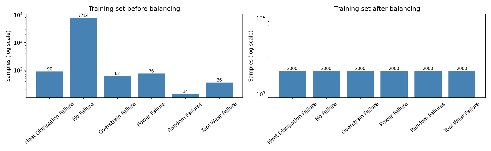
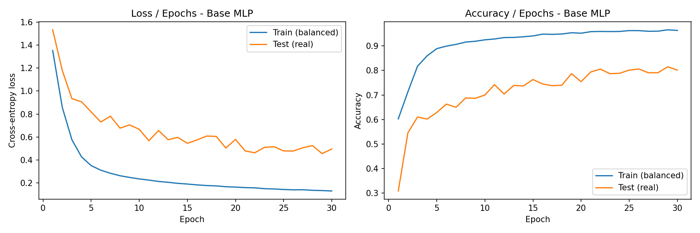
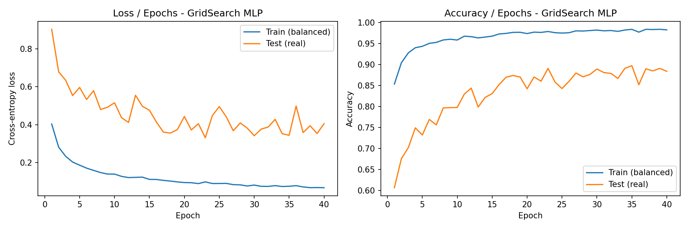
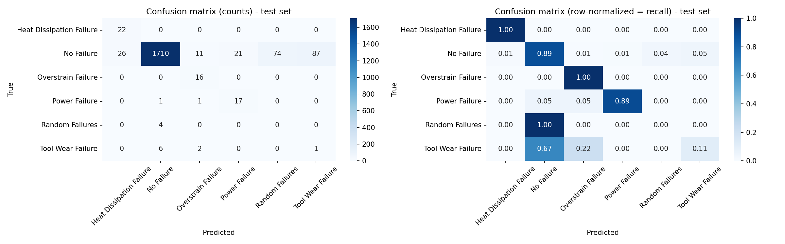
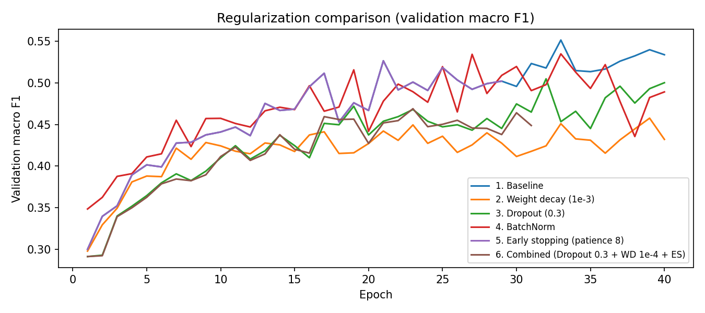

# Deep Learning – Lab 1: Classification and Regression with PyTorch (MLP/DNN)

**Course:** Deep Learning – Pr. Elaachak Lotfi  
**Institution:** Faculté des Sciences et Techniques de Tanger, Université Abdelmalek Essaadi  
**Author:** Lorraine Agnès  
**Tools:** Kaggle Notebooks, PyTorch, scikit-learn, skorch, pandas, matplotlib, seaborn, GitHub

## Objective

Get familiar with the PyTorch library by building DNN/MLP architectures for a regression task (Part 1) and a multi-class classification task (Part 2).

## Repository content

| File | Description |
|---|---|
| `part1_regression.ipynb` | Part 1: regression on the NYSE dataset |
| `part2_classification.ipynb` | Part 2: multi-class classification (to be completed) |
| `images/` | Figures used in this report |

## Part 1 – Regression (NYSE stock prices)

**Dataset:** [New York Stock Exchange](https://www.kaggle.com/datasets/dgawlik/nyse), file `prices-split-adjusted.csv` (about 850,000 daily records for about 500 companies; columns: date, symbol, open, close, low, high, volume).

**Task:** predict the closing price `close` from `open`, `low`, `high` and `volume`.

### 1. Exploratory Data Analysis

- No missing values.
- `open`, `low`, `high` and `close` are almost perfectly correlated (correlation above 0.99), so the regression problem is expected to be easy.
- `volume` has a very skewed distribution and a scale very different from the prices.
- Consequences for preprocessing: a `log1p` transform on `volume` and standardization of all variables.

### 2. Baseline MLP

- **Preprocessing:** `log1p(volume)`, random 80/20 train/test split (`random_state=42`), `StandardScaler` fitted on the training set only (to avoid data leakage) and applied to features and target.
- **Architecture:** 4 → 64 → 32 → 1, ReLU activations, no activation on the output layer.
- **Training:** MSE loss, Adam optimizer, learning rate 1e-3, batch size 1024, 20 epochs.
- **Metric:** since "accuracy" is not meaningful for a regression, the **R² score** is used in place of the accuracy curve requested in the lab.
- **Result:** R² ≈ 0.9999 on both train and test sets.

### 3. Hyperparameter search (GridSearch)

`GridSearchCV` from scikit-learn, with PyTorch models wrapped by `skorch` (`NeuralNetRegressor`). 3-fold cross-validation, R² scoring, on a random subsample of 50,000 training rows to keep the search fast (32 combinations × 3 folds = 96 fits).

| Hyperparameter | Values tested |
|---|---|
| Learning rate | 0.01, 0.001 |
| Optimizer | Adam, SGD |
| Epochs | 10, 20 |
| Neurons per hidden layer | 32, 64 |
| Hidden layers | 1, 2 |

**Best configuration:** Adam, learning rate 0.01, 20 epochs, 2 hidden layers of 64 neurons (cross-validated R² = 0.99986).

### 4. Learning curves (Loss/Epochs and R²/Epochs)

Baseline model:

GridSearch model, retrained on the full training set:

**Interpretation**

- **No overfitting:** train and test curves are almost identical for both models.
- **Baseline model:** the loss reaches its low level in the very first epochs, then fluctuates (R² between 0.99973 and 0.99993). These oscillations come from mini-batch noise with a constant learning rate; they are tiny in absolute terms (about 1e-4 on R²).
- **GridSearch model:** clearly less stable. The loss shows spikes (up to about 6e-3) and the R² drops as low as 0.994 (epoch 17), and ends around 0.9992, below the baseline.
- **The "best" configuration is therefore not better in practice.** Two likely reasons: (1) the search ran on a 50,000-row subsample, where one epoch performs far fewer weight updates than on the full training set, so a learning rate of 0.01 that looked acceptable becomes too aggressive on the full data; (2) the cross-validation score is measured after the last epoch, which is noisy because of the oscillations, and the differences between configurations (5th decimal of R²) are of the same order as this noise.

### 5. Regularization techniques and comparison

Seven variants of the same MLP (4 → 64 → 32 → 1, Adam, lr = 1e-3, 20 epochs) were trained under identical conditions. A validation set (10% of the training set) is used by the scheduler and early stopping, so the test set is never used for decisions.

| Model | R² train | R² test | MSE test | Epochs run | Best epoch (val) | Instability* | Time (s) |
|---|---|---|---|---|---|---|---|
| 1. Baseline | 0.999926 | 0.999924 | 0.000077 | 20 | 17 | 0.000013 | 122.7 |
| 2. Weight decay (1e-4) | 0.999813 | 0.999809 | 0.000193 | 20 | 16 | 0.000035 | 123.3 |
| 3. Dropout (0.1) | 0.998209 | 0.998212 | 0.001801 | 20 | 1 | 0.000443 | 123.4 |
| 4. BatchNorm | 0.999538 | 0.999533 | 0.000471 | 20 | 13 | 0.000179 | 126.4 |
| 5. LR scheduler (ReduceLROnPlateau) | 0.999927 | 0.999925 | 0.000076 | 20 | 16 | 0.000005 | 121.8 |
| 6. Early stopping (patience 5) | 0.999935 | 0.999934 | 0.000067 | 20 | 17 | 0.000013 | 121.5 |
| 7. Combined (BatchNorm + weight decay + scheduler + early stopping) | 0.999751 | 0.999750 | 0.000252 | 10 | 5 | 0.000297 | 65.7 |

\*Standard deviation of the test R² over the last 5 epochs (lower is more stable).

**Analysis**

- **No overfitting to fix:** the train/test R² gap is at most 5e-6 for every variant, so regularization had no generalization gap to reduce on this task.
- **Best results:** early stopping (lowest test MSE, 0.000067), the learning-rate scheduler (the most stable, instability 5e-6) and the baseline are practically equivalent (R² test ≈ 0.99992). The differences (about 1e-5) come from a single run and should not be considered significant.
- **Early stopping:** with patience 5 it never triggered in the standalone run (20 epochs executed); its small gain comes from restoring the weights of the best validation epoch (17) instead of the last epoch.
- **Scheduler:** reducing the learning rate when the validation loss stagnates gives the smoothest curves.
- **Dropout, BatchNorm and weight decay degrade the results.** Likely explanations (not tested): the network is small and the target is an almost deterministic function of the inputs, so Dropout adds noise to the output and BatchNorm adds batch-dependent noise, while weight decay pulls the weights away from the values needed for an almost linear mapping.
- **Combined model:** worse than the baseline. Early stopping triggered at epoch 10 (best epoch 5), probably because the validation loss of the BatchNorm network is noisy. It is the fastest model (65.7 s), but at the cost of accuracy.

### 6. Conclusions and limitations

- A small MLP predicts `close` with R² ≈ 0.9999. The problem is easy because `close` is strongly determined by `open`, `low` and `high`.
- On this problem, regularization improves **stability** (scheduler) and model selection (early stopping with best-weights restoration), not generalization.
- Hyperparameters selected on a subsample did not transfer to full-data training.
- Limitations: random split instead of a chronological split (a real forecasting setting would predict future prices), single random seed (no confidence intervals), a search grid that is small and whose best point lies on its boundary, and R² used as a substitute for accuracy.

## Part 2 – Multi-class classification (Predictive Maintenance)
**Dataset:** [Machine Predictive Maintenance Classification](https://www.kaggle.com/datasets/shivamb/machine-predictive-maintenance-classification), 10,000 records of a machine process (product type, air temperature, process temperature, rotational speed, torque, tool wear), with two label columns: `Target` (failure yes/no) and `Failure Type` (type of failure).

**Task:** multi-class classification of `Failure Type` (6 classes) from the sensor measurements.

### 1. Pre-processing (cleaning and standardization)

**Data quality checks**

- No missing values, no duplicated rows, no duplicated `Product ID`.
- A cross-tabulation of `Target` and `Failure Type` revealed **9 inconsistent rows** (`Target = 1` but `Failure Type = No Failure`). They were **removed** (9,991 rows remain).
- The 18 `Random Failures` rows have `Target = 0` (random failures are not linked to the sensor values). They were **kept** as their own class, but they are expected to be unpredictable.

**Transformations**

| Step | Decision | Reason |
|---|---|---|
| Columns `UDI`, `Product ID` | Dropped | Simple identifiers, no predictive information |
| Column `Target` | Dropped | It is derived from `Failure Type`: keeping it would be **data leakage** |
| Column `Type` (L/M/H) | Ordinal encoding L=0, M=1, H=2 | Quality variants with a natural order |
| Target `Failure Type` | `LabelEncoder` | 0 = Heat Dissipation, 1 = No Failure, 2 = Overstrain, 3 = Power, 4 = Random, 5 = Tool Wear |
| Train/test split | Stratified 80/20 (`random_state=42`): 7,992 / 1,999 samples | Every class keeps its proportion in both sets |
| Standardization | `StandardScaler` (z-score), **fitted on the training set only** | Features have very different scales (about 300 K, 1500 rpm, 40 Nm, 0–250 min); avoids data leakage |

The split is done **before** any resampling: class balancing (see below) is applied to the training set only, and the test set keeps the real, imbalanced distribution.

### 2. Exploratory Data Analysis

**Class distribution**

| Failure Type | Label | Samples | Share |
|---|---|---|---|
| No Failure | 1 | 9,643 | 96.52% |
| Heat Dissipation Failure | 0 | 112 | 1.12% |
| Power Failure | 3 | 95 | 0.95% |
| Overstrain Failure | 2 | 78 | 0.78% |
| Tool Wear Failure | 5 | 45 | 0.45% |
| Random Failures | 4 | 18 | 0.18% |

The dataset is **extremely imbalanced**: a model that always predicts "No Failure" would reach 96.5% accuracy without detecting any failure. Accuracy alone is therefore a misleading metric, and the evaluation will rely on per-class recall and the macro F1-score.

**Features by failure type**

Mean of each variable per class:

| Failure Type | air_temp | process_temp | rot_speed | torque | tool_wear |
|---|---|---|---|---|---|
| Heat Dissipation Failure | 302.6 | 310.8 | 1338.0 | 52.8 | 107.3 |
| No Failure | 300.0 | 310.0 | 1540.4 | 39.6 | 106.7 |
| Overstrain Failure | 299.9 | 310.1 | 1354.2 | 56.9 | 208.2 |
| Power Failure | 300.1 | 310.0 | 1764.0 | 48.5 | 101.9 |
| Random Failures | 300.8 | 310.8 | 1489.4 | 43.5 | 119.9 |
| Tool Wear Failure | 300.3 | 310.2 | 1570.7 | 37.2 | 216.6 |

- **Tool Wear Failure** and **Overstrain Failure** are clearly identified by a high and narrow `tool_wear` (mean about 210–217 min, versus about 107 for normal operation).
- **Overstrain Failure** also has a high torque (56.9 Nm) and a low, narrow rotational speed.
- **Heat Dissipation Failure** has a higher air temperature (302.6 K vs 300.0 K) and a low, narrow rotational speed (about 1,340 rpm).
- **Power Failure** has a very wide spread of both `rot_speed` and `torque`, covering extreme values on both sides, which suggests two distinct failure regimes.
- **Random Failures** show no clear signature: their distributions overlap with normal operation on all variables.
- `process_temp` differs little between classes.

**Torque vs rotational speed**

- Torque and rotational speed follow a strong, **non-linear inverse relationship**, which is consistent with a roughly constant mechanical power during normal operation.
- **Power Failures** are located at the two extremes of this curve: high torque with low speed (top left) and very low torque with high speed (above about 2,150 rpm, bottom right). This is consistent with failures linked to a mechanical power that is too high or too low (hypothesis).
- **Overstrain** and **Heat Dissipation** failures form compact clusters at low speed (about 1,250–1,450 rpm) and medium to high torque.
- **Tool Wear** and **Random** failures lie along the normal operating curve: torque and speed alone cannot separate them from normal operation (for Tool Wear, `tool_wear` is the discriminating variable).

**Correlations**

**Implications for the modelling**

1. The classes are extremely imbalanced, so the **training set must be balanced** (next step) and the evaluation must use **per-class recall, F1-score per class and macro F1**, with a confusion matrix.
2. Several classes overlap with normal operation (Tool Wear, Random), and the relationships are non-linear (torque/speed curve, failures at both extremes). A non-linear model such as an MLP is therefore appropriate.
3. `Random Failures` are expected to remain unpredictable, whatever the model.
4. The stratified test set contains very few samples of the rarest classes (about 4 `Random Failures` and 9 `Tool Wear Failures`), so the metrics on these classes will be noisy.
5. Possible improvement, **not applied in this lab**: engineered features such as the temperature difference, the mechanical power (torque × speed) or torque × tool wear.

### 3. Data augmentation / class balancing

Balancing is applied to the **training set only**; the test set keeps its real, imbalanced distribution.

- `No Failure` is under-sampled to 2,000 samples (`RandomUnderSampler`).
- Each minority class is over-sampled to 2,000 samples with **SMOTENC**. Plain SMOTE would interpolate the categorical `Type` variable and create meaningless values (e.g. 0.37); SMOTENC treats it as categorical and always produces a valid value (0, 1 or 2).
- A hybrid approach was chosen because over-sampling everything up to about 7,700 samples would create thousands of synthetic points from only 14 real `Random Failures`.

| Class | Before | After |
|---|---|---|
| Heat Dissipation Failure | 90 | 2,000 |
| No Failure | 7,714 | 2,000 |
| Overstrain Failure | 62 | 2,000 |
| Power Failure | 76 | 2,000 |
| Random Failures | 14 | 2,000 |
| Tool Wear Failure | 36 | 2,000 |

**Limitation:** the synthetic samples of the rarest classes are interpolations between very few real points (14 for `Random Failures`), so they add little new information. `Random Failures` resemble normal operation, so the model is still expected to detect them poorly.

### 4. MLP architecture

- **Input:** the 6 standardized features. **Output:** 6 logits (one per failure type), with `CrossEntropyLoss` (softmax included in the loss).
- **Architecture:** 6 → 64 → 32 → 6, ReLU activations.
- **Training:** Adam, learning rate 1e-3, 30 epochs, batch size 256, on the balanced training set (12,000 samples). The real test set (1,999 samples) is evaluated after each epoch.

### 5. Hyperparameter search (GridSearch)

`GridSearchCV` from scikit-learn with `skorch` (`NeuralNetClassifier`).

**Leak-free validation.** A standard cross-validation on the balanced training set would put synthetic points derived from the same real sample in both the training and validation folds, and inflate the scores. Instead:
- the original (real) training set was split 80/20 (stratified);
- the 80% part was balanced with the same method as in step 3 (12,000 samples);
- the 20% part (1,599 samples) was kept **untouched**, with the real imbalanced distribution, as the validation set;
- a `PredefinedSplit` makes `GridSearchCV` use exactly this split.

**Score:** macro F1-score (accuracy would reward a model that always predicts "No Failure").

| Hyperparameter | Values tested |
|---|---|
| Learning rate | 0.01, 0.001 |
| Optimizer | Adam, SGD |
| Epochs | 20, 40 |
| Neurons per hidden layer | 32, 64 |
| Hidden layers | 1, 2 |

**Best configuration:** Adam, learning rate 0.01, 40 epochs, 1 hidden layer of 64 neurons (validation macro F1 = 0.345).

| lr | Epochs | Neurons | Layers | Optimizer | Validation macro F1 |
|---|---|---|---|---|---|
| 0.01 | 40 | 64 | 1 | Adam | 0.345 |
| 0.001 | 40 | 64 | 2 | Adam | 0.336 |
| 0.01 | 40 | 32 | 2 | Adam | 0.331 |
| 0.01 | 40 | 32 | 1 | Adam | 0.330 |
| 0.01 | 20 | 64 | 1 | Adam | 0.316 |

**Comments**

- The macro F1 is low because the validation set keeps the real distribution (about 96.5% `No Failure`) while the model is trained on balanced data: it tends to raise false alarms on healthy machines, which lowers the precision of the minority classes, and `Random Failures` (about 3 validation samples) are essentially unpredictable. These explanations are hypotheses; the per-class metrics (section 7) give the detail.
- The differences between the top configurations are small and come from a single validation split with very few rare-class samples, so they should not be over-interpreted.
- The best configuration lies on the boundary of the grid (largest learning rate, 40 epochs, and the top 4 all use 40 epochs): a wider grid could give slightly better results.
- Unlike in Part 1, the search was run on training data of the same size as the final training set (12,000 samples), so the selected hyperparameters transfer better to the final training.

### 6. Learning curves

Curves are plotted for the base MLP and for the GridSearch MLP. The training curve is computed on the **balanced** training set and the test curve on the **real** (imbalanced) test set, so their absolute values are not directly comparable.

GridSearch MLP, logged every 5 epochs:

| Epoch | Train loss | Test loss | Train accuracy | Test accuracy |
|---|---|---|---|---|
| 1 | 0.4037 | 0.9036 | 0.8531 | 0.6063 |
| 5 | 0.1861 | 0.5964 | 0.9429 | 0.7319 |
| 10 | 0.1391 | 0.5157 | 0.9579 | 0.7974 |
| 15 | 0.1110 | 0.4760 | 0.9672 | 0.8304 |
| 20 | 0.0943 | 0.4432 | 0.9733 | 0.8419 |
| 25 | 0.0895 | 0.4953 | 0.9745 | 0.8424 |
| 30 | 0.0811 | 0.3417 | 0.9817 | 0.8889 |
| 35 | 0.0748 | 0.3439 | 0.9834 | 0.8969 |
| 40 | 0.0671 | 0.4054 | 0.9822 | 0.8834 |

**Interpretation**

- The training loss decreases steadily and the training accuracy reaches about 98%.
- The test loss decreases much more slowly, stays 5 to 6 times higher (0.34 to 0.50) and fluctuates from one epoch to another: there is a clear gap between training and test performance.
- The test accuracy rises from 0.61 to about 0.89 and is still improving until epoch 35, then drops slightly at epoch 40. This is consistent with the best configuration lying on the boundary of the grid (40 epochs) and suggests that the model could still benefit from more training.
- The gap is partly structural (the model is trained on balanced data and evaluated on imbalanced data) and partly overfitting on the rare classes (see section 7).
- <<Base MLP: describe what you see in images/p2_curves_base.png (convergence speed, stability, gap between train and test).>>

### 7. Metrics

Metrics were computed for both models on three sets: the balanced training set (what the model has seen), the training set with its real distribution, and the real test set. *Sensitivity* is the recall (share of the true failures of a class that are detected).

| Model | Set | Accuracy | Precision (macro) | Sensitivity (macro recall) | F1 (macro) | F1 (weighted) |
|---|---|---|---|---|---|---|
| Base MLP | Train (balanced) | 0.9632 | 0.9651 | 0.9632 | 0.9623 | 0.9623 |
| Base MLP | Train (real distribution) | 0.8197 | 0.4077 | 0.9054 | 0.4855 | 0.8844 |
| Base MLP | Test (real distribution) | 0.8014 | 0.3941 | 0.6813 | 0.4625 | 0.8730 |
| GridSearch MLP | Train (balanced) | 0.9822 | 0.9826 | 0.9822 | 0.9819 | 0.9819 |
| GridSearch MLP | Train (real distribution) | 0.8946 | 0.4484 | 0.9284 | 0.5377 | 0.9301 |
| GridSearch MLP | Test (real distribution) | 0.8834 | 0.4073 | 0.6487 | 0.4797 | 0.9224 |

**Per-class results of the GridSearch MLP on the test set**

| Failure Type | Precision | Recall (sensitivity) | F1-score | Support |
|---|---|---|---|---|
| Heat Dissipation Failure | 0.458 | 1.000 | 0.629 | 22 |
| No Failure | 0.994 | 0.886 | 0.937 | 1929 |
| Overstrain Failure | 0.533 | 1.000 | 0.696 | 16 |
| Power Failure | 0.447 | 0.895 | 0.596 | 19 |
| Random Failures | 0.000 | 0.000 | 0.000 | 4 |
| Tool Wear Failure | 0.011 | 0.111 | 0.021 | 9 |

**Analysis**

- **Distribution shift.** The performance drop already appears on the real training data (accuracy 0.895, macro precision 0.448) and is similar on the test set (0.883, 0.407). It is therefore mostly caused by the change of class distribution (balanced for training, about 96.5% `No Failure` in reality), which lowers the precision of the minority classes.
- **Overfitting on rare classes.** The macro recall is 0.928 on the real training set but 0.649 on the test set: the model detects the rare failures it has already seen far better than new ones.
- **Well-detected failures.** `Heat Dissipation`, `Overstrain` and `Power` failures are detected almost perfectly (recall 1.00, 1.00 and 0.89: 55 of 57 failures), but with a precision of only 0.45 to 0.53, because of false alarms.
- **False alarms.** 219 of the 1,929 healthy machines (11.4%) are flagged as failing. This is why the accuracy (88.3%) is lower than that of a trivial model that always predicts "No Failure" (96.5%): the model trades accuracy for the detection of failures.
- **Undetected failures.** `Tool Wear` (recall 0.11) and `Random Failures` (recall 0.00) are essentially not detected. 87 healthy machines are predicted as `Tool Wear` and 74 as `Random Failures`. A likely explanation (hypothesis) is that these classes overlap with normal operation (see the EDA), so their thousands of synthetic samples, generated from only 36 and 14 real points, cover the region of normal operation.
- **Base vs GridSearch.** The GridSearch MLP is better in accuracy (0.883 vs 0.801) and slightly better in macro F1 (0.480 vs 0.463), with a slightly lower macro recall (0.649 vs 0.681). The improvement is modest and comes from a single run.
- **Reliability of the numbers.** The test set contains only 4 `Random Failures` and 9 `Tool Wear Failures`: one more correct prediction changes the recall of `Tool Wear` by 11 points, so the metrics of these classes are very noisy.
- **Possible improvements (not tested):** a milder balancing (keeping more `No Failure` samples), class weights in the loss, adjusting the decision thresholds, or engineered features (temperature difference, mechanical power, torque × tool wear).

### 8. Regularization and comparison

Six variants of the best architecture found by the GridSearch (6 → 64 → 6, Adam, learning rate 0.01, 40 epochs) were trained under identical conditions:

- **Training data:** the balanced "fit" part of the training set (12,000 samples), without the validation samples.
- **Validation:** the real validation set (1,599 samples, never used for training), used to select the best epoch (macro F1).
- **Test:** the real test set, used for the final report only.

The baseline was **retrained in this setup**, so its numbers differ from section 7 (where the model was trained on the whole balanced training set).

| Model | Train acc (balanced) | Best val macro F1* | Test acc | Test macro precision | Test macro recall | Test macro F1 | Epochs run | Best epoch (val) | Time (s) |
|---|---|---|---|---|---|---|---|---|---|
| 1. Baseline | 0.9877 | 0.5512 | 0.9135 | 0.4265 | 0.6278 | 0.4932 | 40 | 33 | 4.9 |
| 2. Weight decay (1e-3) | 0.9680 | 0.4575 | 0.8249 | 0.3452 | 0.6484 | 0.4119 | 40 | 39 | 4.9 |
| 3. Dropout (0.3) | 0.9814 | 0.5047 | 0.8924 | 0.4049 | 0.6687 | 0.4806 | 40 | 32 | 5.3 |
| 4. BatchNorm | 0.9812 | 0.5346 | 0.8934 | 0.4060 | 0.6146 | 0.4728 | 40 | 33 | 5.4 |
| 5. Early stopping (patience 8) | 0.9808 | 0.5263 | 0.8969 | 0.4426 | 0.6250 | 0.5023 | 29 | 21 | 3.6 |
| 6. Combined (Dropout 0.3 + weight decay 1e-4 + early stopping) | 0.9760 | 0.4689 | 0.8724 | 0.3886 | 0.6381 | 0.4589 | 31 | 23 | 4.0 |

\*Maximum validation macro F1 reached during training. For the runs without early stopping, the evaluated model is the one of the last epoch.

The baseline and the early-stopping runs use the same seed and therefore follow the same trajectory until early stopping triggers at epoch 29, so the baseline curve is hidden behind it.

**Analysis**

- **Early stopping** gives the best test macro F1 (0.502) and the best macro precision (0.443), and needs fewer epochs (29 instead of 40). The gain over the baseline (+0.009 in macro F1) is however too small to be considered significant.
- **Weight decay (1e-3)** clearly degrades the results (test macro F1 0.412, accuracy 0.825, and a lower training accuracy): the penalty is probably too strong for this small network, which then underfits. Other values were not tested.
- **Dropout (0.3)** gives the highest macro recall (0.669) but a lower accuracy and precision: the model detects more failures but raises more false alarms. Its macro F1 (0.481) is slightly below the baseline.
- **BatchNorm** gives the noisiest validation curve and no improvement (macro F1 0.473).
- **Combined:** stacking the techniques did not add up (macro F1 0.459, below each of its components taken alone).
- **No technique clearly beats the baseline.** All of them slightly reduce the training accuracy (0.988 to 0.976–0.981) without improving the test performance. The gap between training and test performance mainly comes from the change of class distribution and from the scarcity of rare-class samples (see section 7), which generic regularizers do not address.
- **Noise.** The same configuration reaches a test accuracy of 0.883 when trained on the whole balanced training set (section 7) and 0.914 here: a 3-point difference without any regularization, as large as most differences between techniques. The test set contains only 4 `Random Failures` and 9 `Tool Wear Failures`, the validation macro F1 fluctuates by several points from one epoch to the next (the validation set has only about 3 and 7 samples of these classes), and a single seed was used. Only the large effect (weight decay at 1e-3 hurts) is reliable; the other differences cannot be distinguished from noise. A firm ranking would require several seeds or cross-validation.

### 9. Conclusions and limitations (Part 2)

- A careful pipeline was set up: cleaning of inconsistent labels, removal of the leaking `Target` column, stratified split **before** any resampling, scaler fitted on the training set only, and balancing applied to the training data only (hybrid under-sampling + SMOTENC).
- The final MLP reaches a test accuracy of about 0.88–0.91 and a macro F1 of about 0.48–0.50. It detects three failure types reliably (recall of at least 0.89 for `Heat Dissipation`, `Overstrain` and `Power`) but with many false alarms (about 11% of healthy machines flagged), and it essentially fails on `Tool Wear` and `Random Failures`.
- Regularization did not bring a clear improvement; early stopping was the most useful technique (same performance, fewer epochs).
- **Limitations:** very few samples for the rarest classes (14 `Random Failures` and 36 `Tool Wear Failures` in the training set, 4 and 9 in the test set), so all metrics for these classes are noisy; a single random seed; a balancing level (2,000 per class) that is probably too aggressive for the rarest classes; no feature engineering; no tuning of the decision thresholds.
- **Perspectives:** milder balancing, class weights in the loss, engineered features (temperature difference, mechanical power, torque × tool wear), threshold tuning, and repeated runs or cross-validation to compare techniques reliably.

## What I learned

- Building and training an MLP in PyTorch: tensors, `Dataset`/`DataLoader`, the training loop and the evaluation loop, for both regression and multi-class classification.
- Preventing data leakage: fitting the scaler on the training data only, splitting before resampling, removing a column derived from the target, and keeping a separate validation set so that the test set is never used for decisions.
- Running a hyperparameter search with scikit-learn and skorch, and its pitfalls: a search on a subsample may not transfer to full-data training, a cross-validation on synthetic data leaks information (a `PredefinedSplit` with a real validation set avoids this), and noisy scores make small differences meaningless.
- Accuracy is misleading on imbalanced data: per-class recall, macro F1-score and the confusion matrix tell the real story. Balancing the training set shifts the class distribution and trades accuracy for the detection of rare failures (more false alarms).
- Reading learning curves (overfitting, convergence, oscillations) and choosing suitable axis scales.
- Regularization is not an automatic improvement: its usefulness depends on whether the model actually overfits, and with very few samples per class and a single run, small differences between techniques cannot be interpreted.

## How to run

1. Open the notebooks on Kaggle and add the datasets as inputs: [NYSE](https://www.kaggle.com/datasets/dgawlik/nyse) and [Machine Predictive Maintenance Classification](https://www.kaggle.com/datasets/shivamb/machine-predictive-maintenance-classification).
2. Enable Internet in the notebook settings (needed to install `skorch`).
3. Run all cells from top to bottom.
