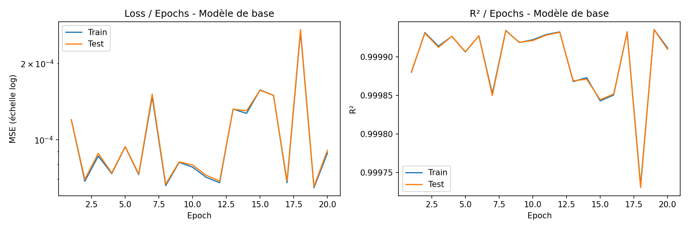
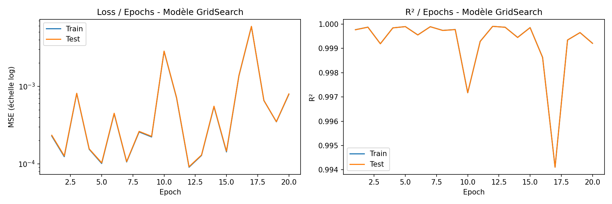
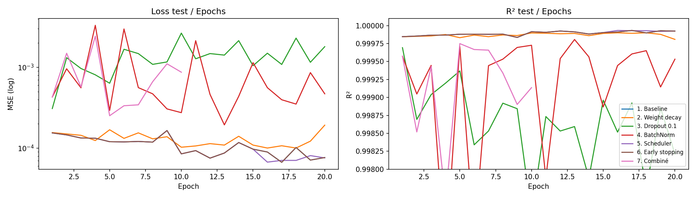
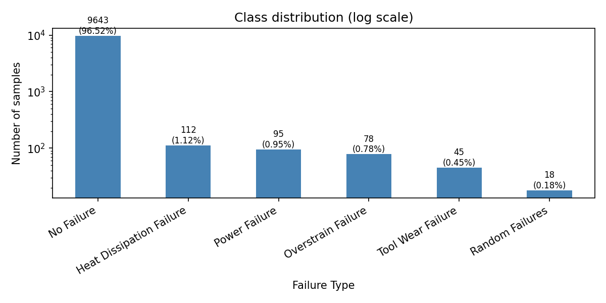
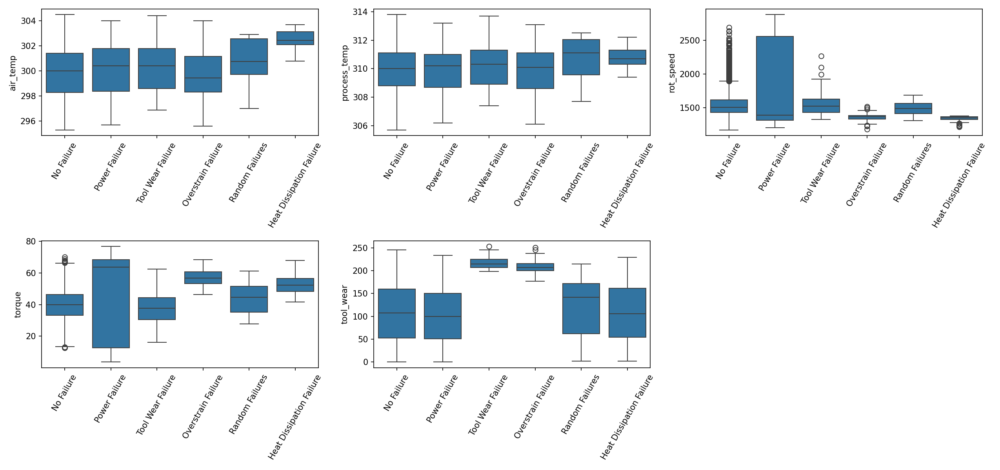
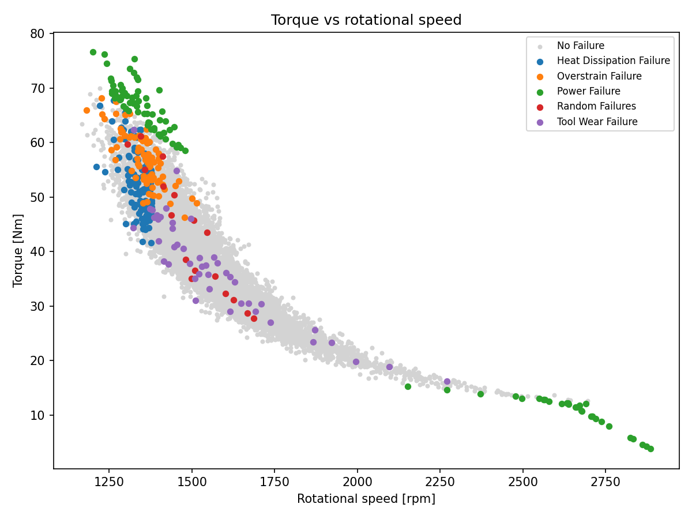
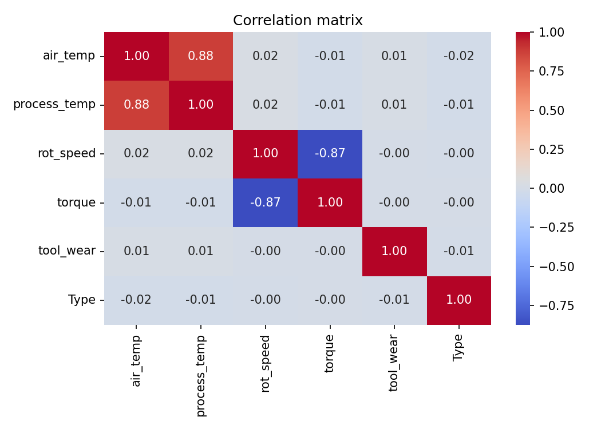

# Deep Learning – Lab 1: Classification and Regression with PyTorch (MLP/DNN)

**Course:** Deep Learning – Pr. Elaachak Lotfi  
**Institution:** Faculté des Sciences et Techniques de Tanger, Université Abdelmalek Essaadi  
**Author:** Lorraine Agnès  
**Tools:** Kaggle Notebooks, PyTorch, scikit-learn, skorch, pandas, matplotlib, seaborn, GitHub

## Objective

Get familiar with the PyTorch library by building DNN/MLP architectures for a regression task (Part 1) and a multi-class classification task (Part 2).

## Repository content

| File | Description |
|---|---|
| `part1_regression.ipynb` | Part 1: regression on the NYSE dataset |
| `part2_classification.ipynb` | Part 2: multi-class classification (to be completed) |
| `images/` | Figures used in this report |

## Part 1 – Regression (NYSE stock prices)

**Dataset:** [New York Stock Exchange](https://www.kaggle.com/datasets/dgawlik/nyse), file `prices-split-adjusted.csv` (about 850,000 daily records for about 500 companies; columns: date, symbol, open, close, low, high, volume).

**Task:** predict the closing price `close` from `open`, `low`, `high` and `volume`.

### 1. Exploratory Data Analysis

- No missing values.
- `open`, `low`, `high` and `close` are almost perfectly correlated (correlation above 0.99), so the regression problem is expected to be easy.
- `volume` has a very skewed distribution and a scale very different from the prices.
- Consequences for preprocessing: a `log1p` transform on `volume` and standardization of all variables.

### 2. Baseline MLP

- **Preprocessing:** `log1p(volume)`, random 80/20 train/test split (`random_state=42`), `StandardScaler` fitted on the training set only (to avoid data leakage) and applied to features and target.
- **Architecture:** 4 → 64 → 32 → 1, ReLU activations, no activation on the output layer.
- **Training:** MSE loss, Adam optimizer, learning rate 1e-3, batch size 1024, 20 epochs.
- **Metric:** since "accuracy" is not meaningful for a regression, the **R² score** is used in place of the accuracy curve requested in the lab.
- **Result:** R² ≈ 0.9999 on both train and test sets.

### 3. Hyperparameter search (GridSearch)

`GridSearchCV` from scikit-learn, with PyTorch models wrapped by `skorch` (`NeuralNetRegressor`). 3-fold cross-validation, R² scoring, on a random subsample of 50,000 training rows to keep the search fast (32 combinations × 3 folds = 96 fits).

| Hyperparameter | Values tested |
|---|---|
| Learning rate | 0.01, 0.001 |
| Optimizer | Adam, SGD |
| Epochs | 10, 20 |
| Neurons per hidden layer | 32, 64 |
| Hidden layers | 1, 2 |

**Best configuration:** Adam, learning rate 0.01, 20 epochs, 2 hidden layers of 64 neurons (cross-validated R² = 0.99986).

### 4. Learning curves (Loss/Epochs and R²/Epochs)

Baseline model:

GridSearch model, retrained on the full training set:

**Interpretation**

- **No overfitting:** train and test curves are almost identical for both models.
- **Baseline model:** the loss reaches its low level in the very first epochs, then fluctuates (R² between 0.99973 and 0.99993). These oscillations come from mini-batch noise with a constant learning rate; they are tiny in absolute terms (about 1e-4 on R²).
- **GridSearch model:** clearly less stable. The loss shows spikes (up to about 6e-3) and the R² drops as low as 0.994 (epoch 17), and ends around 0.9992, below the baseline.
- **The "best" configuration is therefore not better in practice.** Two likely reasons: (1) the search ran on a 50,000-row subsample, where one epoch performs far fewer weight updates than on the full training set, so a learning rate of 0.01 that looked acceptable becomes too aggressive on the full data; (2) the cross-validation score is measured after the last epoch, which is noisy because of the oscillations, and the differences between configurations (5th decimal of R²) are of the same order as this noise.

### 5. Regularization techniques and comparison

Seven variants of the same MLP (4 → 64 → 32 → 1, Adam, lr = 1e-3, 20 epochs) were trained under identical conditions. A validation set (10% of the training set) is used by the scheduler and early stopping, so the test set is never used for decisions.

| Model | R² train | R² test | MSE test | Epochs run | Best epoch (val) | Instability* | Time (s) |
|---|---|---|---|---|---|---|---|
| 1. Baseline | 0.999926 | 0.999924 | 0.000077 | 20 | 17 | 0.000013 | 122.7 |
| 2. Weight decay (1e-4) | 0.999813 | 0.999809 | 0.000193 | 20 | 16 | 0.000035 | 123.3 |
| 3. Dropout (0.1) | 0.998209 | 0.998212 | 0.001801 | 20 | 1 | 0.000443 | 123.4 |
| 4. BatchNorm | 0.999538 | 0.999533 | 0.000471 | 20 | 13 | 0.000179 | 126.4 |
| 5. LR scheduler (ReduceLROnPlateau) | 0.999927 | 0.999925 | 0.000076 | 20 | 16 | 0.000005 | 121.8 |
| 6. Early stopping (patience 5) | 0.999935 | 0.999934 | 0.000067 | 20 | 17 | 0.000013 | 121.5 |
| 7. Combined (BatchNorm + weight decay + scheduler + early stopping) | 0.999751 | 0.999750 | 0.000252 | 10 | 5 | 0.000297 | 65.7 |

\*Standard deviation of the test R² over the last 5 epochs (lower is more stable).

**Analysis**

- **No overfitting to fix:** the train/test R² gap is at most 5e-6 for every variant, so regularization had no generalization gap to reduce on this task.
- **Best results:** early stopping (lowest test MSE, 0.000067), the learning-rate scheduler (the most stable, instability 5e-6) and the baseline are practically equivalent (R² test ≈ 0.99992). The differences (about 1e-5) come from a single run and should not be considered significant.
- **Early stopping:** with patience 5 it never triggered in the standalone run (20 epochs executed); its small gain comes from restoring the weights of the best validation epoch (17) instead of the last epoch.
- **Scheduler:** reducing the learning rate when the validation loss stagnates gives the smoothest curves.
- **Dropout, BatchNorm and weight decay degrade the results.** Likely explanations (not tested): the network is small and the target is an almost deterministic function of the inputs, so Dropout adds noise to the output and BatchNorm adds batch-dependent noise, while weight decay pulls the weights away from the values needed for an almost linear mapping.
- **Combined model:** worse than the baseline. Early stopping triggered at epoch 10 (best epoch 5), probably because the validation loss of the BatchNorm network is noisy. It is the fastest model (65.7 s), but at the cost of accuracy.

### 6. Conclusions and limitations

- A small MLP predicts `close` with R² ≈ 0.9999. The problem is easy because `close` is strongly determined by `open`, `low` and `high`.
- On this problem, regularization improves **stability** (scheduler) and model selection (early stopping with best-weights restoration), not generalization.
- Hyperparameters selected on a subsample did not transfer to full-data training.
- Limitations: random split instead of a chronological split (a real forecasting setting would predict future prices), single random seed (no confidence intervals), a search grid that is small and whose best point lies on its boundary, and R² used as a substitute for accuracy.

## Part 2 – Multi-class classification (Predictive Maintenance)
**Dataset:** [Machine Predictive Maintenance Classification](https://www.kaggle.com/datasets/shivamb/machine-predictive-maintenance-classification), 10,000 records of a machine process (product type, air temperature, process temperature, rotational speed, torque, tool wear), with two label columns: `Target` (failure yes/no) and `Failure Type` (type of failure).

**Task:** multi-class classification of `Failure Type` (6 classes) from the sensor measurements.

### 1. Pre-processing (cleaning and standardization)

**Data quality checks**

- No missing values, no duplicated rows, no duplicated `Product ID`.
- A cross-tabulation of `Target` and `Failure Type` revealed **9 inconsistent rows** (`Target = 1` but `Failure Type = No Failure`). They were **removed** (9,991 rows remain).
- The 18 `Random Failures` rows have `Target = 0` (random failures are not linked to the sensor values). They were **kept** as their own class, but they are expected to be unpredictable.

**Transformations**

| Step | Decision | Reason |
|---|---|---|
| Columns `UDI`, `Product ID` | Dropped | Simple identifiers, no predictive information |
| Column `Target` | Dropped | It is derived from `Failure Type`: keeping it would be **data leakage** |
| Column `Type` (L/M/H) | Ordinal encoding L=0, M=1, H=2 | Quality variants with a natural order |
| Target `Failure Type` | `LabelEncoder` | 0 = Heat Dissipation, 1 = No Failure, 2 = Overstrain, 3 = Power, 4 = Random, 5 = Tool Wear |
| Train/test split | Stratified 80/20 (`random_state=42`): 7,992 / 1,999 samples | Every class keeps its proportion in both sets |
| Standardization | `StandardScaler` (z-score), **fitted on the training set only** | Features have very different scales (about 300 K, 1500 rpm, 40 Nm, 0–250 min); avoids data leakage |

The split is done **before** any resampling: class balancing (see below) is applied to the training set only, and the test set keeps the real, imbalanced distribution.

### 2. Exploratory Data Analysis

**Class distribution**

| Failure Type | Label | Samples | Share |
|---|---|---|---|
| No Failure | 1 | 9,643 | 96.52% |
| Heat Dissipation Failure | 0 | 112 | 1.12% |
| Power Failure | 3 | 95 | 0.95% |
| Overstrain Failure | 2 | 78 | 0.78% |
| Tool Wear Failure | 5 | 45 | 0.45% |
| Random Failures | 4 | 18 | 0.18% |

The dataset is **extremely imbalanced**: a model that always predicts "No Failure" would reach 96.5% accuracy without detecting any failure. Accuracy alone is therefore a misleading metric, and the evaluation will rely on per-class recall and the macro F1-score.

**Features by failure type**

Mean of each variable per class:

| Failure Type | air_temp | process_temp | rot_speed | torque | tool_wear |
|---|---|---|---|---|---|
| Heat Dissipation Failure | 302.6 | 310.8 | 1338.0 | 52.8 | 107.3 |
| No Failure | 300.0 | 310.0 | 1540.4 | 39.6 | 106.7 |
| Overstrain Failure | 299.9 | 310.1 | 1354.2 | 56.9 | 208.2 |
| Power Failure | 300.1 | 310.0 | 1764.0 | 48.5 | 101.9 |
| Random Failures | 300.8 | 310.8 | 1489.4 | 43.5 | 119.9 |
| Tool Wear Failure | 300.3 | 310.2 | 1570.7 | 37.2 | 216.6 |

- **Tool Wear Failure** and **Overstrain Failure** are clearly identified by a high and narrow `tool_wear` (mean about 210–217 min, versus about 107 for normal operation).
- **Overstrain Failure** also has a high torque (56.9 Nm) and a low, narrow rotational speed.
- **Heat Dissipation Failure** has a higher air temperature (302.6 K vs 300.0 K) and a low, narrow rotational speed (about 1,340 rpm).
- **Power Failure** has a very wide spread of both `rot_speed` and `torque`, covering extreme values on both sides, which suggests two distinct failure regimes.
- **Random Failures** show no clear signature: their distributions overlap with normal operation on all variables.
- `process_temp` differs little between classes.

**Torque vs rotational speed**

- Torque and rotational speed follow a strong, **non-linear inverse relationship**, which is consistent with a roughly constant mechanical power during normal operation.
- **Power Failures** are located at the two extremes of this curve: high torque with low speed (top left) and very low torque with high speed (above about 2,150 rpm, bottom right). This is consistent with failures linked to a mechanical power that is too high or too low (hypothesis).
- **Overstrain** and **Heat Dissipation** failures form compact clusters at low speed (about 1,250–1,450 rpm) and medium to high torque.
- **Tool Wear** and **Random** failures lie along the normal operating curve: torque and speed alone cannot separate them from normal operation (for Tool Wear, `tool_wear` is the discriminating variable).

**Correlations**

**Implications for the modelling**

1. The classes are extremely imbalanced, so the **training set must be balanced** (next step) and the evaluation must use **per-class recall, F1-score per class and macro F1**, with a confusion matrix.
2. Several classes overlap with normal operation (Tool Wear, Random), and the relationships are non-linear (torque/speed curve, failures at both extremes). A non-linear model such as an MLP is therefore appropriate.
3. `Random Failures` are expected to remain unpredictable, whatever the model.
4. The stratified test set contains very few samples of the rarest classes (about 4 `Random Failures` and 9 `Tool Wear Failures`), so the metrics on these classes will be noisy.
5. Possible improvement, **not applied in this lab**: engineered features such as the temperature difference, the mechanical power (torque × speed) or torque × tool wear.

### 3. Data augmentation / class balancing

*To be completed.*

### 4. MLP, hyperparameter search, curves, metrics and regularization

*To be completed.*

## What I learned

- Building and training an MLP in PyTorch: tensors, `Dataset`/`DataLoader`, the training loop and the evaluation loop.
- Fitting the scaler on the training data only to avoid data leakage, and keeping a separate validation set so that the test set is never used for decisions.
- Running a hyperparameter search with scikit-learn and skorch, and its pitfalls: a search on a subsample may not transfer to full-data training, and noisy scores make small differences meaningless.
- Reading learning curves (overfitting, convergence, oscillations) and choosing the right scale for the axes.
- Regularization is not an automatic improvement: its usefulness depends on whether the model actually overfits.

## How to run

1. Open the notebooks on Kaggle and add the datasets as inputs: [NYSE](https://www.kaggle.com/datasets/dgawlik/nyse) and [Machine Predictive Maintenance Classification](https://www.kaggle.com/datasets/shivamb/machine-predictive-maintenance-classification).
2. Enable Internet in the notebook settings (needed to install `skorch`).
3. Run all cells from top to bottom.
